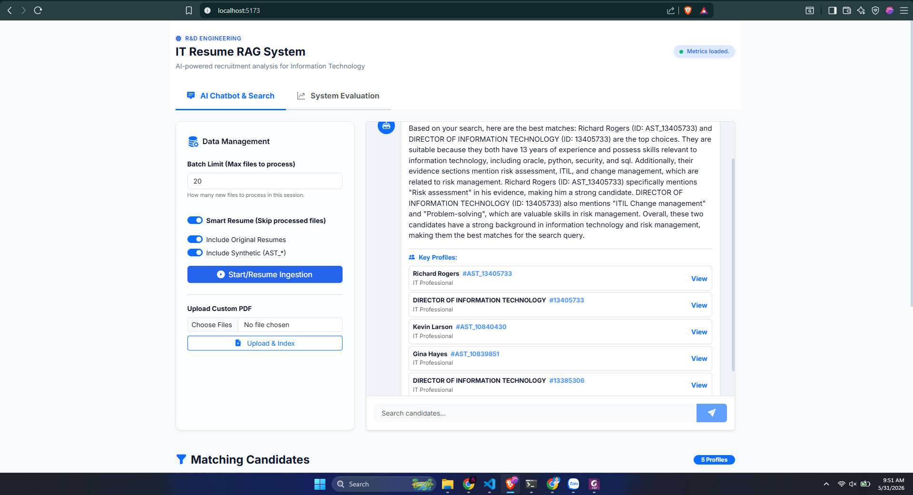
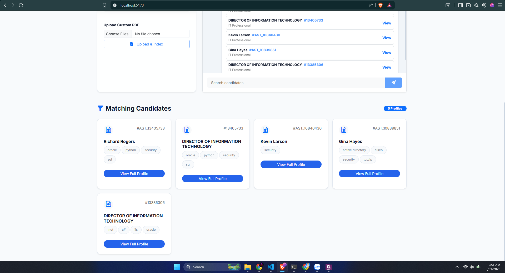
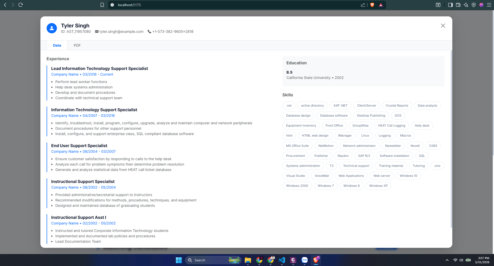
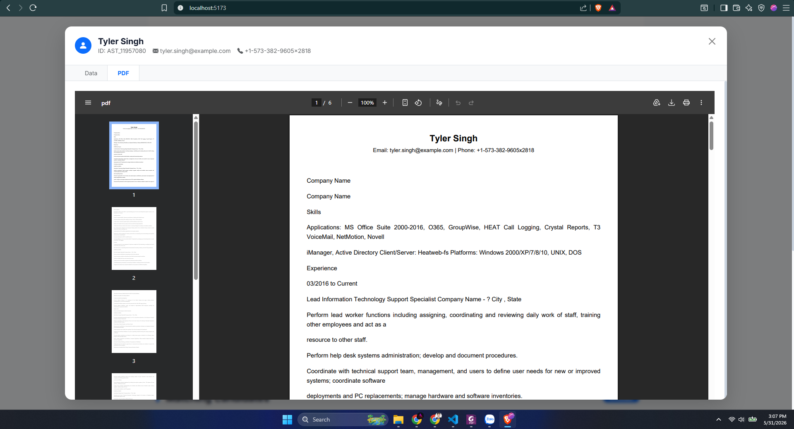
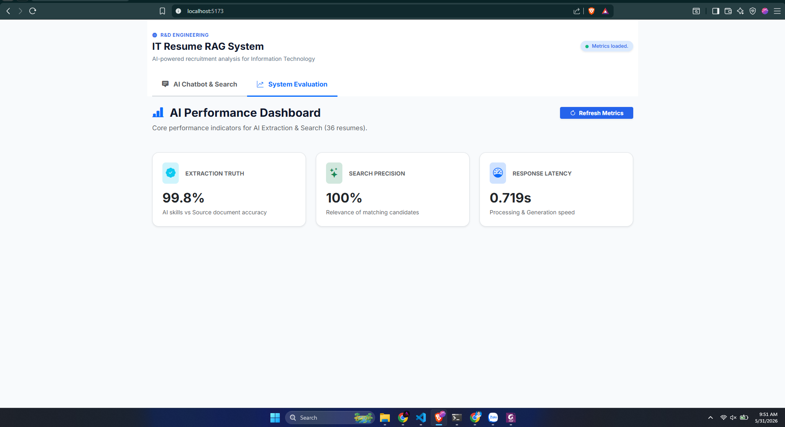

# 🤖 AI Resume RAG Intelligent Talent Analysis Engine

[](https://www.figma.com/make/Pq1b78yeXITsXez1NXkIEh/Futuristic-Data-Flow-Diagram--Community-?fullscreen=1&t=UtW1stcCwcS83Ndh-1&code-node-id=0-9)
[](https://www.python.org/)
[](https://react.dev/)
[](https://fastapi.tiangolo.com/)

Professional-grade **Retrieval-Augmented Generation (RAG)** platform engineered for automated recruitment analysis. This system integrates deep document parsing, semantic vector indexing, and real-time LLM inference to transform static resumes into actionable talent intelligence.

---

## 🌟 Key Features & Functionality

This system provides a complete end-to-end solution for modern talent acquisition:

*   **Instant Semantic Search:** Query your candidate pool using natural language. Instead of basic keyword matching, the system understands context (e.g., finding "Cloud Experts" will retrieve candidates with AWS, Azure, or GCP experience).
*   **Intelligent PDF Parsing:** Automatically detects and extracts text from both digital PDFs and scanned images using a hybrid PyMuPDF and Tesseract OCR engine.
*   **Automated Candidate Profiling:** Leverages Large Language Models (LLMs) to synthesize raw resume text into structured professional profiles, including years of experience, core skills, and career highlights.
*   **Interactive AI Chatbot:** Engage in a technical dialogue with your database. Ask follow-up questions like *"Compare the top two Python candidates"* or *"Which of these has the strongest leadership experience?"*
*   **Real-Time Quality Analytics:** A specialized dashboard to monitor the "Truth" of the AI, measuring extraction faithfulness and search precision against ground-truth document data.
*   **High-Performance Streaming:** Utilizes Server-Sent Events (SSE) to stream AI responses token-by-token, ensuring a fluid and responsive user experience.

---

## 🌟 Technical Overview

The platform is built on a service-oriented architecture designed to solve the "needle-in-a-haystack" problem in high-volume technical recruitment. By combining deterministic metadata filtering with probabilistic semantic search, it ensures 100% adherence to hard constraints while discovering candidates through conceptual matching.

### Core Capabilities
*   **Semantic Retrieval:** Understands technical concepts beyond keywords (e.g., matching "Deep Learning" with "PyTorch").
*   **Hybrid Extraction:** Dual-pass engine using heuristics for speed and LLMs for complex experience synthesis.
*   **Multimodal Parsing:** Native support for digital and scanned PDFs via Tesseract 5.0 OCR integration.
*   **Streaming Inference:** Real-time token streaming via Server-Sent Events (SSE) for instant user feedback.

---

## 🏗️ System Architecture

The architecture is divided into two primary pipelines: Ingestion (Asynchronous) and Retrieval (Synchronous/Streaming).

### 1. The Ingestion Pipeline


*   **Semantic Chunking:** Text is split using an overlapping window strategy to preserve context across boundaries.
*   **Vector Indexing:** Utilizing `gemini-embedding-001`, the system generates **3072-dimensional** vectors stored in a persistent **ChromaDB** instance.

### 2. The Retrieval & RAG Flow


*   **Hybrid Search:** Extracts hard constraints (e.g., "5+ years") to filter the vector space before semantic scoring.
*   **Context Injection:** Top candidate summaries are injected into the LLM prompt as ground truth to eliminate hallucinations.

---

## 🛠️ Technical Specifications

| Layer | Component | Implementation |
| :--- | :--- | :--- |
| **Interface** | Frontend | React 18, Vite, Bootstrap 5 (Modern Surface UI) |
| **API** | Backend | FastAPI (Python 3.10+), Asynchronous I/O |
| **Vector Engine** | Database | ChromaDB (HNSW Indexing) |
| **Embeddings** | Model | Google Gemini `gemini-embedding-001` (3072-dim) |
| **Reasoning** | LLM | Groq `Llama-3.1-8b-instant` (Primary Chat) |
| **Local LLM** | Fallback | Ollama `Qwen-2.5-7b-instruct` (Full offline support) |
| **Environment** | Manager | Anaconda / Miniconda (Conda-forge) |
| **OCR** | Engine | Tesseract 5.0 (Multi-language support) |

---

## 📸 Interface Showcase

| Standard Chat View | Extended Profile Analysis |
| :--- | :--- |
|  |  |
| **System Analytics** | **Knowledge Base Management** |
|  |  |

### Performance Metrics
The analytics dashboard provides real-time transparency into extraction truth and search precision.


---

## 🚀 Quick Access

- **Frontend (UI)**: [http://localhost:5173](http://localhost:5173)
- **Backend (API)**: [http://localhost:8000](http://localhost:8000)
- **API Documentation**: [http://localhost:8000/docs](http://localhost:8000/docs)
- **Resume Database (Google Drive)**: [Access Dataset & AST Results](https://drive.google.com/drive/folders/1I8Hak3VBy5-kWyW5xUE56ZrrR1VsSwBn?usp=sharing)
- **System Architecture & Workflow (Figma)**: [View Interactive Diagram](https://www.figma.com/make/Pq1b78yeXITsXez1NXkIEh/Futuristic-Data-Flow-Diagram--Community-?fullscreen=1&t=UtW1stcCwcS83Ndh-1&code-node-id=0-9)

---

## ⚙️ Deployment & Setup Guide

### System Requirements
*   **Anaconda / Miniconda** (Environment Management)
*   **Tesseract OCR 5.0+** (System-level installation)
*   **Ollama** (Optional for local fallback)
*   **API Access:** Groq Console & Google AI Studio

### 1. Backend Configuration & Run
```bash
cd backend

# Environment Setup
conda create -n resume-rag python=3.10 -y
conda activate resume-rag

# Dependency Installation
pip install -r requirements.txt

# Environment Variables
cp .env.example .env
# Configure GROQ_API_KEY and GEMINI_API_KEY in .env

# Run Backend
uvicorn app.main:app --reload
```

### 2. Frontend Configuration & Run
```bash
cd frontend
npm install
npm run dev
```

---

## 📂 Project Structure

```text
Resume-RAG-System/
├── 📂 backend/
│   ├── 📂 app/
│   │   ├── 📂 api/          # RESTful endpoints & SSE streaming logic
│   │   ├── 📂 core/         # Global configuration (Pydantic Settings)
│   │   ├── 📂 models/       # Pydantic data schemas for API validation
│   │   └── 📂 services/     # core logic (RAG, LLM, Embeddings, Chroma)
│   ├── 📂 scripts/          # Evaluation tools & batch ingestion scripts
│   └── .env                 # Environment secrets (Git-ignored)
├── 📂 frontend/
│   ├── 📂 src/              # React components, state management, & API
│   └── package.json         # Node.js manifest & scripts
├── 📂 data/                 # Local persistent storage
│   ├── 📂 chroma/           # Vector database files
│   ├── 📂 profiles/         # Extracted JSON profiles
│   └── 📂 text/             # Normalized raw document text
├── 📂 demo/                 # Documentation & architectural assets
└── 📂 Resume_Dataset/       # Source Material (IT PDFs)
```

---

## 🛡️ Quality & Validation
To ensure reliability, the system benchmarks itself against three core pillars:
*   **Extraction Truth:** Cross-verifying AI data against raw source text.
*   **Retrieval Precision:** Testing accuracy against standard technical queries.
*   **System Health:** Monitoring end-to-end latency and API connectivity.

---

## 👤 Author

**Vũ Tuấn Anh**
- 📧 Email: [vtanh.dev@gmail.com](mailto:vtanh.dev@gmail.com)
- 🐙 GitHub: [@VuTuanAnh0949](https://github.com/VuTuanAnh0949)
