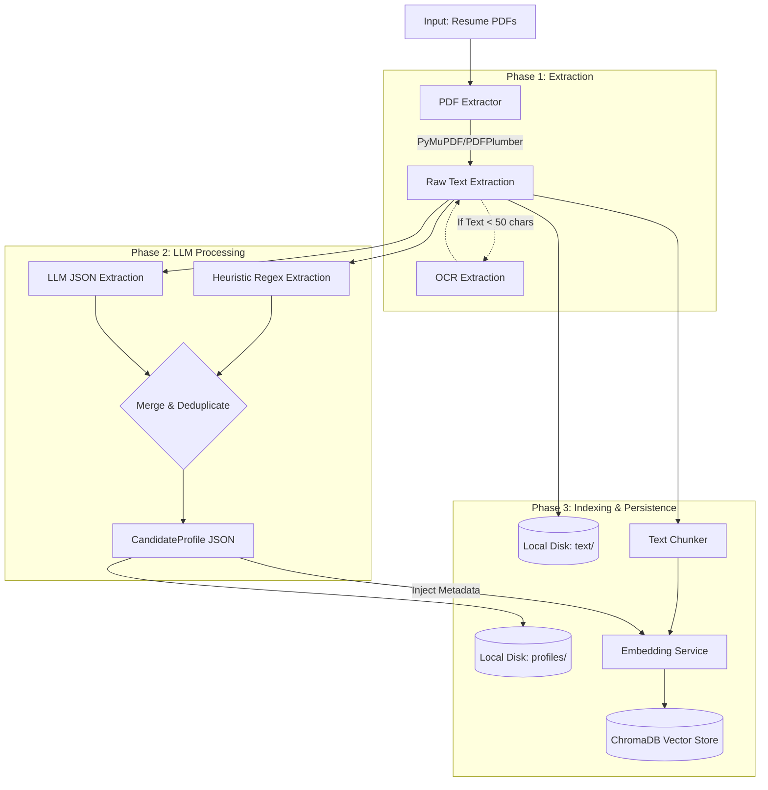
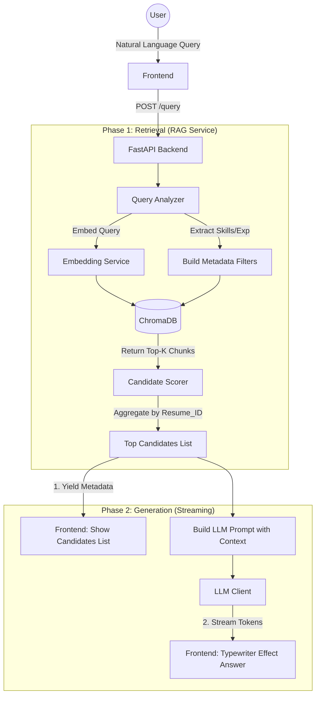

# System Architecture & Data Flow

This document describes the end-to-end architecture and data workflows of the Resume RAG System.

## 1. High-Level Architecture

The system follows a modern RAG (Retrieval-Augmented Generation) pattern, combining traditional data extraction with semantic search and generative AI.

- **Frontend:** React + Vite (Single Page Application)
- **Backend:** FastAPI (Python)
- **Vector Database:** ChromaDB (Local SQLite-based storage)
- **LLM Engine:** Multi-provider support (Gemini, Groq, Ollama)

---

## 2. Ingestion Workflow (Data Processing)

This flow is triggered when batch-processing the dataset via script (`ingest_it.py`) or when uploading new PDF files via the UI.

### Key Steps:
1. **Extraction:** The system first attempts direct text extraction from PDFs. If the PDF is an image (scanned), OCR is triggered.
2. **Hybrid Information Extraction:** To ensure reliability and speed, the system uses regex/heuristics to quickly find emails, phones, and known skills. It simultaneously asks the LLM to read the whole text and generate a structured JSON profile. The results are merged.
3. **Chunking & Embedding:** The raw text is split into overlapping chunks. These chunks are embedded into vector representations (via Gemini/Google APIs) and stored in ChromaDB alongside the structured metadata (skills, years of experience, domain).

---

## 4. Query & RAG Workflow

This flow occurs when a user asks a natural language question (e.g., "Find candidates with Python and 5+ years of experience").

### Key Steps:
1. **Query Analysis:** Before hitting the database, the system parses the query to extract hard constraints (e.g., "5 years", "Python").
2. **Hybrid Search:** It performs a vector similarity search in ChromaDB, applying the extracted hard constraints as *Metadata Filters*. This guarantees that if a user asks for "5+ years", only candidates meeting that criteria are considered.
3. **Response Streaming:** The backend immediately sends the structured data (candidates list) to the UI so the user can see results instantly. It then builds a prompt containing the query and the top candidates' summaries, passing it to the LLM. The LLM's answer is streamed back token-by-token for a fast, conversational UX.

---

## 5. Evaluation Workflow

The system includes a script (`scripts/evaluate.py`) to measure its own performance against the requirements.

1. **Extraction Coverage:** Measures what percentage of resumes successfully had names, emails, skills, etc., extracted.
2. **Retrieval Quality:** Runs predefined questions (from the test assignment) and checks if the top-ranked candidate actually possesses the required skills and experience.
3. **Latency:** Measures the average time taken to retrieve and generate an answer.
